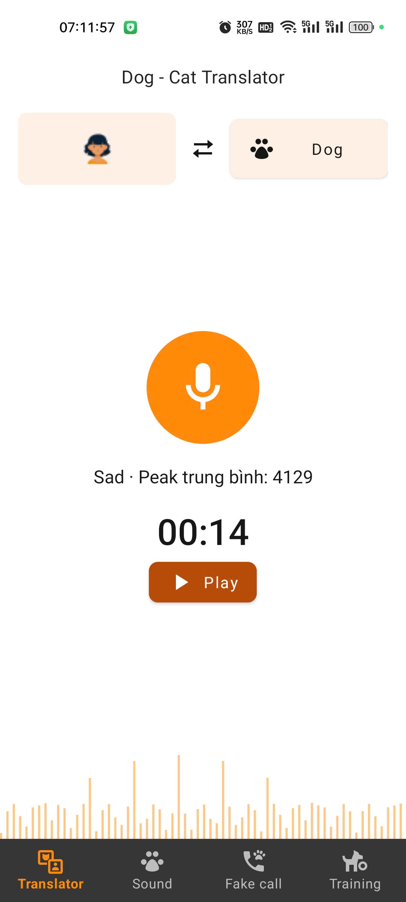
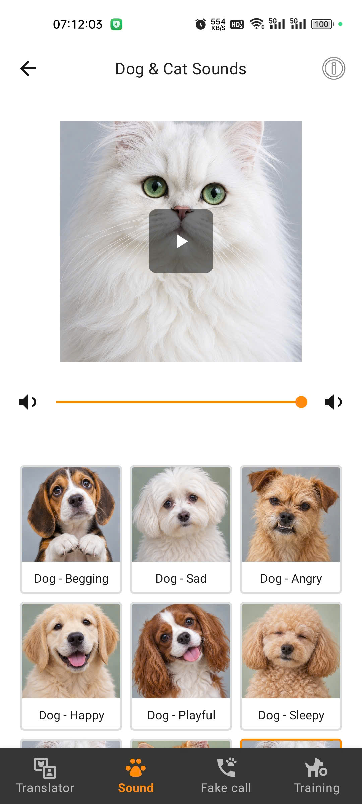
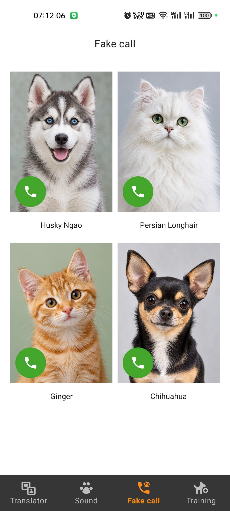
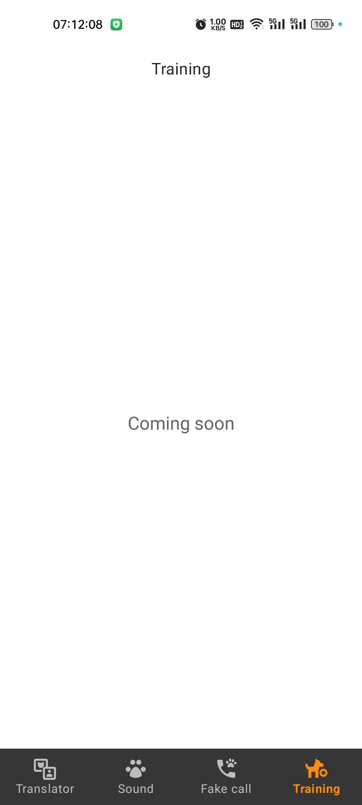
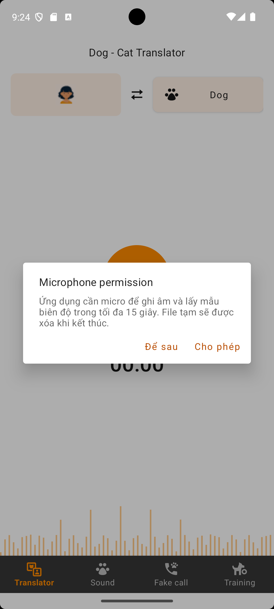
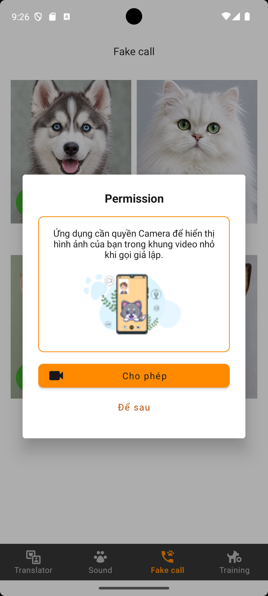

# Dog & Cat Translator

Ứng dụng Android giải trí với ba tính năng chính: mô phỏng dịch giọng nói sang tiếng chó/mèo, nghe âm thanh thú cưng và giả lập cuộc gọi video. Project sử dụng **Kotlin, XML, ViewBinding và MVVM**, tập trung vào xử lý âm thanh, video, camera và vòng đời Android.

Translator chọn âm thanh có sẵn dựa trên biên độ giọng nói thu được. Đây là tính năng mô phỏng, không phải công cụ dịch ngôn ngữ hay nhận diện cảm xúc của thú cưng.

## Video demo

▶ **[Xem video demo trên YouTube Shorts](https://youtube.com/shorts/zr2N9HJwsFk?feature=share)**

## Hình ảnh ứng dụng

<table>
  <tr><th>Translator</th><th>Sound</th></tr>
  <tr>
    <td></td>
    <td></td>
  </tr>
  <tr><th>Fake Call</th><th>Training</th></tr>
  <tr>
    <td></td>
    <td></td>
  </tr>
  <tr><th>Microphone permission</th><th>Camera permission</th></tr>
  <tr>
    <td></td>
    <td></td>
  </tr>
</table>

## Tính năng

### Translator — Dịch giả lập

- Chọn **Dog** hoặc **Cat**, nhấn micro để bắt đầu ghi âm.
- Ghi tối đa **15 giây**, hỗ trợ dừng sớm và hiển thị thời gian ghi.
- Lấy mẫu `MediaRecorder.getMaxAmplitude()` khoảng mỗi **100 ms**, tính trung bình các mẫu peak và phân loại thành `SILENT`, `LOW`, `MEDIUM`, `HIGH`.
- Chọn âm thanh theo loài và mức biên độ, tự phát kết quả bằng `MediaPlayer`; có thể phát lại.
- Thông báo khi âm thanh quá nhỏ, quyền micro bị từ chối hoặc ghi âm gặp lỗi.

```text
Chọn Dog/Cat → Ghi âm → Tính trung bình peak → Chọn sound → Phát kết quả
```

Các nhãn như Sad, Begging hay Angry là nhãn của âm thanh demo. Giá trị peak không phải tần số Hz, dB hoặc RMS; ứng dụng không dùng FFT hay mô hình AI để dịch.

### Sound — Thư viện âm thanh

- Thư viện **9 âm thanh**: 6 của chó và 3 của mèo, hiển thị trong lưới 3 cột.
- Chọn thẻ để cập nhật ảnh lớn và làm nổi bật mục đang chọn.
- Phát, tạm dừng, tiếp tục, tua và phát lại bằng `MediaPlayer`.
- Không tự phát khi mở tab; đổi mục sẽ dừng âm thanh cũ để tránh phát chồng.
- Có mục thông tin nguồn và giấy phép âm thanh ngay trong ứng dụng.

### Fake Call — Cuộc gọi video giả lập

- Chọn một trong bốn thú cưng: **Husky Ngao, Persian Longhair, Ginger, Chihuahua**.
- Luồng màn hình gồm danh sách, cuộc gọi đến và cuộc gọi đang diễn ra; hỗ trợ nhận, từ chối và kết thúc.
- Phát video thú cưng có sẵn bằng **AndroidX Media3 ExoPlayer**, lặp lại khi hết clip.
- Hiển thị **camera trước thật** qua **CameraX PreviewView** ở góc trên bên phải.
- Có popup giải thích quyền camera, đồng hồ cuộc gọi và nút bật/tắt camera.
- Nút biểu tượng micro điều khiển tiếng của video local; cuộc gọi không ghi âm micro hay truyền âm thanh hai chiều.

```text
Chọn thú cưng → Xin quyền camera → Incoming Call → Accept → In Call → End Call
```

Toàn bộ cuộc gọi được mô phỏng cục bộ, không sử dụng mạng điện thoại, WebRTC hay máy chủ cuộc gọi. Hình ảnh camera chỉ dùng để xem trực tiếp, không lưu hoặc tải lên mạng.

### Training

Tab **Training** hiện hiển thị **Coming soon**, chưa có chức năng huấn luyện.

## Công nghệ và kiến trúc

| Thành phần | Công nghệ |
| --- | --- |
| Ngôn ngữ | Kotlin |
| Giao diện | XML Views, Material Components, ViewBinding |
| Kiến trúc | MVVM, ViewModel, StateFlow |
| Tác vụ bất đồng bộ | Kotlin Coroutines, lifecycle-aware collection |
| Điều hướng và danh sách | Navigation Component, RecyclerView |
| Ghi và phát âm thanh | MediaRecorder, MediaPlayer |
| Phát video | AndroidX Media3 ExoPlayer |
| Camera | CameraX, PreviewView |
| Kiểm thử | JUnit, AndroidJUnitRunner, Espresso, UI Automator |

Fragment/Activity xử lý giao diện, quyền và vòng đời tài nguyên. ViewModel quản lý trạng thái; repository cung cấp dữ liệu thú cưng và media local. Các manager tách riêng việc ghi âm, phát media và điều khiển camera.

```text
app/src/
├── main/
│   ├── java/com/example/dogcattranslator/
│   │   ├── MainActivity.kt
│   │   ├── data/          # Model và repository dữ liệu local
│   │   ├── media/         # Recorder, phân tích peak, audio/video player
│   │   ├── camera/        # Điều khiển CameraX preview
│   │   └── ui/            # Home, Sound, Fake Call, Training, thành phần chung
│   ├── res/               # Layout XML, icon, chuỗi, audio và video
│   └── assets/            # Ảnh và thông tin nguồn media
├── test/                  # Unit tests
└── androidTest/           # Instrumentation tests
readme-assets/screenshots/ # Ảnh minh họa trong README
```

## Cài đặt và chạy

### Yêu cầu môi trường

- Android Studio hỗ trợ **Android Gradle Plugin 9.0.1**.
- Android SDK **36**; thiết bị hoặc emulator chạy **Android 7.0 / API 24** trở lên.
- Project dùng **Gradle Wrapper 9.1.0**, Kotlin tích hợp trong AGP và Java source/target **17**. Có thể dùng JBR **21** của Android Studio để chạy Gradle.
- Thiết bị có micro và camera trước để trải nghiệm đầy đủ.

### Chạy bằng Android Studio

1. Mở thư mục gốc chứa `settings.gradle.kts`.
2. Cài SDK Platform 36 nếu chưa có, cấu hình Android SDK trong IDE hoặc `local.properties` trên máy cá nhân.
3. Đồng bộ Gradle, chọn module `app` và thiết bị chạy.
4. Nhấn **Run**, cấp quyền micro/camera khi ứng dụng yêu cầu.

## Quyền và tài nguyên

| Quyền | Khi sử dụng | Mục đích |
| --- | --- | --- |
| `RECORD_AUDIO` | Bắt đầu ghi ở Translator | Thu giọng nói để lấy mẫu biên độ |
| `CAMERA` | Bắt đầu luồng Fake Call cần camera | Hiển thị preview camera trước |

Ứng dụng hoạt động offline với ảnh, 9 MP3 và 4 MP4 đóng gói sẵn; không cần quyền Internet, điện thoại hoặc truy cập bộ nhớ dùng chung. File ghi âm nằm trong cache riêng và được dọn sau mỗi lượt. Khi rời màn hình hoặc đưa ứng dụng xuống nền, recorder, player và camera được dừng/giải phóng theo vòng đời.

Thông tin nguồn và giấy phép media có tại [media-credits.txt](app/src/main/assets/media-credits.txt) và trong mục thông tin của màn Sound. Video và tiếng ghép là tài nguyên demo; tiếng không phải bản thu đồng bộ của cá thể xuất hiện trong clip. Khi tài nguyên âm thanh/video bị thiếu hoặc không đọc được, ứng dụng hiển thị thông báo lỗi.

Ngưỡng phân loại biên độ hiện tại là **500 / 5000 / 10000**, cần hiệu chỉnh theo micro và môi trường thực tế. Phạm vi hiện tại chưa bao gồm dịch thật, dịch ngược từ thú cưng sang người, huấn luyện, tài khoản hay backend.
